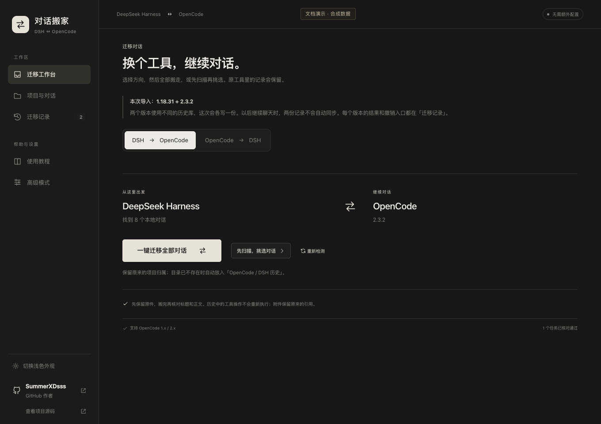
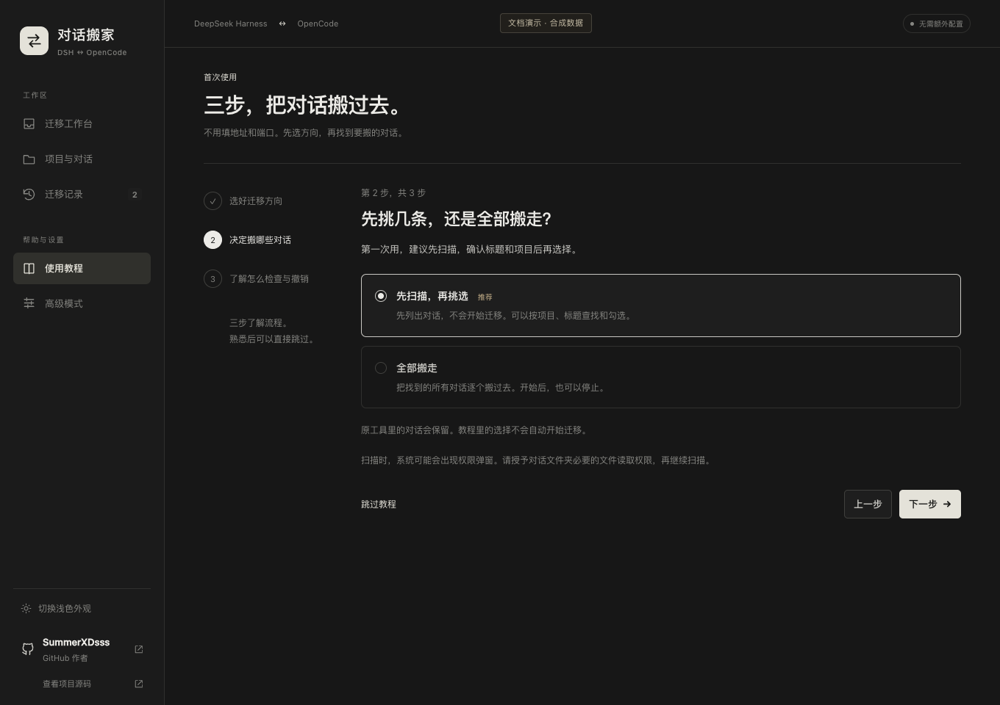
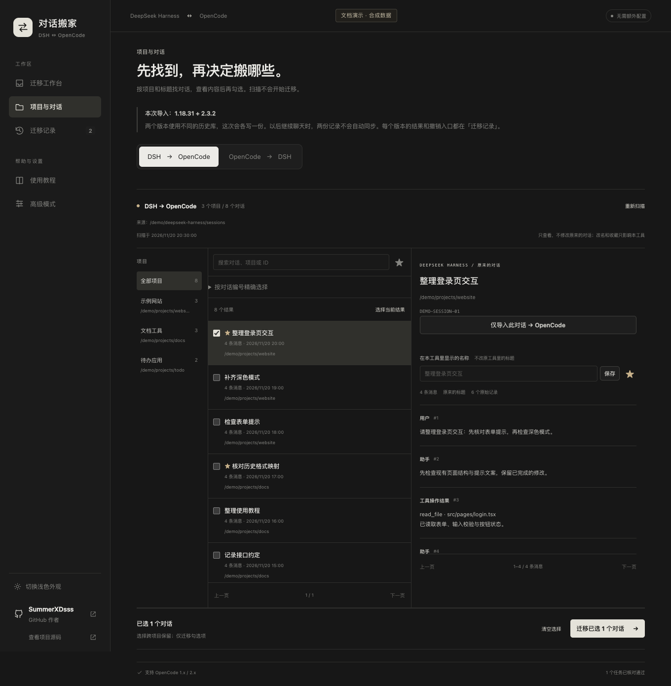
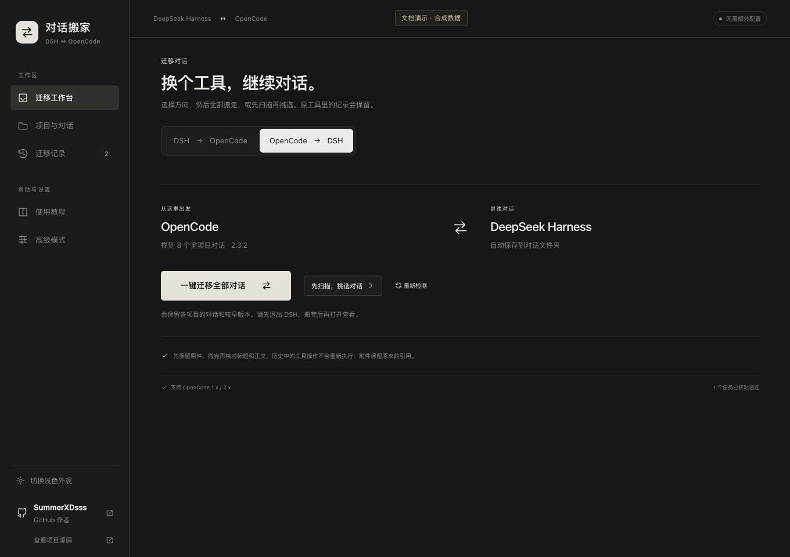
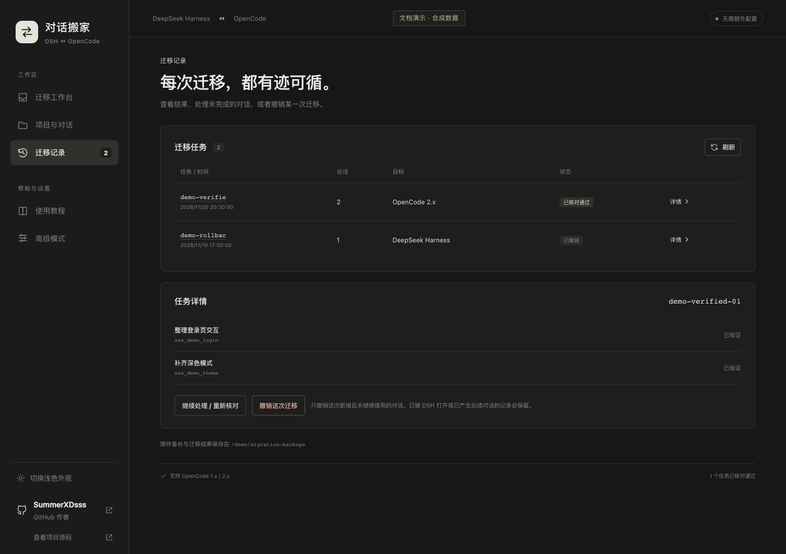

# 对话搬家 · DSH ↔ OpenCode

**换个工具，继续原来的对话。**

在 DeepSeek Harness 和 OpenCode 之间双向迁移历史。可以一键全部搬走，也可以先扫描，按项目、标题或对话 ID 挑选。普通桌面流程无需填写地址、端口或令牌。

[开始使用](#开始使用) · [界面一览](#界面一览) · [本地构建](#本地构建) · [格式与边界](#能保留什么) · [高级用法](#高级用法) · [许可证](#许可证)



> **图片说明：** 本文 5 张图由当前桌面前端渲染，统一使用合成示例数据，并标有「文档演示 · 合成数据」。项目、对话、数量和任务状态仅用于说明界面，不是实际用户历史，也不是额外的迁移验收结果。[图片来源与复现方式](docs/images/README.md)。

## 你可以用它做什么？

| 你想做的事 | 操作方式 |
| --- | --- |
| 换到另一款工具继续聊 | 选择 **DSH → OpenCode** 或 **OpenCode → DSH** |
| 把找到的历史一起搬走 | 工作台点击 **一键迁移全部对话** |
| 只迁移某个项目或几条对话 | **先扫描，挑选对话** → 按项目浏览 → 勾选后迁移 |
| 只导入一条指定记录 | 粘贴原对话 ID，或在预览里点击 **仅导入此对话** |
| 看清原来的上下文 | 在管理器预览正文和历史工具记录，确认后再迁移 |
| 检查结果，或撤销一次迁移 | 打开 **迁移记录**，查看任务详情与撤销入口 |

原工具里的历史会保留。迁入后会回读核对标题与正文；已继续聊天或被修改的目标记录会受到撤销保护。迁移不会重新执行历史工具操作。

## 开始使用

### 1. 获取桌面应用

[查看已发布的安装包](https://github.com/SummerXDsss/dsh-oc-migrate/releases)；下载时以实际列出的系统、架构和文件为准。**当前采用本地构建交付**，GitHub Actions 额度耗尽不会影响本机打包。[本地构建步骤](#本地构建) · [Windows / 普通 Linux 说明](docs/PLATFORMS.md)。

桌面安装包内置迁移中间件和运行时，使用时无需另装 Node.js、Bun 或 DSH 插件。插件接收和 CLI 仍保留在高级流程中。

### 2. 选方向，再决定搬哪些

首次打开会显示三步教程：**选方向 → 决定搬哪些对话 → 了解检查与撤销**。第一次使用，建议先扫描，核对项目名、对话标题和内容，再选择少量记录迁移。

扫描时，系统可能出现权限弹窗，请授予对话所在文件夹必要的文件读取权限。教程本身不会启动迁移，可以跳过，也可以从左侧「使用教程」重看。

### 3. 回到目标工具查看

迁移完成后，打开目标工具的对应项目，从会话列表选择新记录。OpenCode CLI 与 Desktop 如果使用不同代际或不同服务器，需要分别确认目标；**同机的 1.x 和 2.x 默认各导入一份，但后续聊天不会自动同步**。

反向迁入 DeepSeek Harness 前，请先完全退出 DSH；完成后重新打开它查看。想撤销时，回到本工具的「迁移记录」，只清理本次新增且未继续使用的记录。

## 界面一览

### 首次使用：照着三步走

不先让你填写一屏配置，而是先说明迁移方向、选择方式，以及完成后如何检查。自定义位置、插件和连接信息放在独立的「高级模式」。



### 项目与对话：先看清，再勾选

左侧按项目整理，中间按标题搜索和勾选，右侧预览原来的内容。改显示名称、收藏只影响本工具；也能直接导入正在预览的这一条，不连带其他勾选项。[管理器详细说明](docs/MANAGER.md)。



### 双向切换：箭头指向搬入的工具

从 OpenCode 搬回 DSH，也使用同一套扫描、选择和核对流程。切换方向后会清空旧勾选与预览，避免把上一次选择带到另一方向。



### 迁移记录：结果、原件和撤销放在一起

每次迁移都有任务记录，可以查看具体对话、继续处理未完成项，或撤销这次迁移。原件备份会保留；已经产生后续聊天的对话不会被简单清空。



## 能保留什么？

| 内容 | 处理方式 |
| --- | --- |
| 项目、标题、正文 | 识别来源名称与项目路径，导入后原生回读核对 |
| 思考、工具调用与结果 | 参照双方原生 Schema 分代转换；不重新执行历史操作 |
| 用量、时间、结束与错误状态 | 按支持的原生字段映射，不把中断伪装成正常完成 |
| 压缩前的较早内容 | 原始事件留存；默认可额外生成「归档全文」会话 |
| 附件、文件与分支引用 | 保留引用和可获取的原始结构；不等价项提供快照与提示 |
| 原件与迁移凭据 | 本地保存，支持核对、重试及受保护的撤销 |

**不是所有格式都能一一等价。** 外部附件引用不等于文件字节；OpenCode export 内嵌数据可留存并回程恢复，但尚未写入 DSH 原生附件库。未映射的分支关系、特殊角色和扩展事件保留原件或历史快照，不宣称完整跨端无损恢复。

`all` 指查询 backend 当前能列出的历史，不包含已经删除或不可访问的记录。这也不是实时同步工具，不会覆盖合并已经继续聊天的原有会话。[逐字段格式映射](docs/FORMATS.md) · [双向迁移与撤销边界](docs/BIDIRECTIONAL.md)。

## 本地构建

准备好 Node.js ≥ 22.19、Bun、Rust 和当前系统的 Tauri 构建依赖后，在项目目录执行：

```bash
npm ci
npm run release:local
```

命令会完成本地检查和构建，把**当前系统与架构**的安装包、DSH 插件、精确源码提交清单和 SHA-256 校验文件放到 `artifacts/releases/`。不调用 GitHub Actions，也不覆盖之前的安装包。[环境准备与原生回归选项](docs/LOCAL_RELEASE.md)。

| 本地机器 | 对应安装包 |
| --- | --- |
| Apple 芯片 Mac / Intel Mac | 各自架构的 DMG 和应用归档 |
| Windows x64 | NSIS `.exe` |
| Linux x64 | DEB、RPM、AppImage，以及无 FUSE 启动脚本 |

各平台需要在相应构建环境中产出与验证；一台 Mac 构建成功不等于 Windows / Linux 构建通过。自动 Release 工作流仍保留，只有全部平台及回归成功才发布完整产物。

开发桌面界面：

```bash
npm run desktop:dev
```

## 怎样工作？

桌面应用的三段工作链保持独立：读取源历史 → 本地中间件保存原件并转换 → 目标原生导入与回读。插件是可选的读取入口，不是普通桌面迁移的必需步骤。

```text
DeepSeek Harness 历史 / Host 插件
                ↕
       本地中间件：原件、转换、核对、撤销
                ↕
 OpenCode 1.x / 2.x 原生历史 → CLI / 对应 GUI 后端
```

CLI 与 GUI 必须读取实际写入的同一后端。连接另一台服务器时，不能把本地数据库的导入成功当作远端 GUI 已经可见。[桌面说明](docs/DESKTOP.md) · [调研与源码依据](docs/RESEARCH.md)。

## 高级用法

普通桌面迁移可以直接略过下面内容。只有使用 DSH Host 插件、离线迁移包、远程后端，或需要脚本化操作时再展开。

<details>
<summary><strong>展开：插件、CLI、离线转换与 HTTP 后端</strong></summary>

## 1. 安装与初始化

Node.js ≥ 22.19：

```bash
npm ci
npm run check
npm test
npm pack

node bin/dsh-oc-migrate.mjs init --state "$HOME/.local/share/dsh-oc-migrate"
```

令牌只写入权限为 `0600` 的文件，不打印到终端。以下命令中的项目路径请替换成实际 OpenCode 工作目录。

## 2. 启动本地中间件

```bash
node bin/dsh-oc-migrate.mjs serve \
  --directory /absolute/path/to/project \
  --token-file "$HOME/.local/share/dsh-oc-migrate/receiver.token" \
  --auto-import
```

默认只监听 `127.0.0.1:48765`。省略 `--auto-import` 时只接收并转换，检查后用 `retry JOB_ID` 导入。接收端目标目录和二进制由本机启动参数决定，导出包不能指定执行命令。

- `--binary /path/to/opencode`：选择二进制；默认执行 PATH 中的 `opencode`。
- `--generation auto|v1|v2`：自动读取版本，或强制校验版本。
- `--data-home /path/to/isolated/data`：隔离 OpenCode 数据目录；GUI 也必须连接相同后端才会看到会话。
- `--provider deepseek --model deepseek-chat`：显式重绑历史模型标识。继续对话前在 OpenCode 选择可用模型。
- `--no-archive`：只导入有效上下文，仍保存完整原始包。
- `--no-state-snapshots`：不向会话追加 goal/todo 文字快照，原始事件仍保留。

### GUI 连接的是另一台 2.x 服务器

```bash
node bin/dsh-oc-migrate.mjs serve \
  --directory /absolute/server/project \
  --token-file /absolute/path/receiver.token \
  --server http://127.0.0.1:4096 \
  --password-file /absolute/path/opencode-server-password \
  --auto-import
```

HTTP 适配器使用 OpenCode 2.x 原生 `/api/experimental/session/import`，并导出回读验证；认证默认为用户名 `opencode` 的 Basic Auth。使用 GUI 实际连接的服务器，不要把独立本地数据库的成功当作远端 GUI 成功。

## 3. DSH 插件

将 `npm pack` 生成的 `dsh-oc-migrate-VERSION.tgz` 安装进 DSH 对应 profile，或在该 profile 中安装本仓库。参考配置如下（完整步骤见 [插件配置](docs/PLUGIN.md)）：

```yaml
- id: dsh-oc-migrate
  config:
    receiver: http://127.0.0.1:48765
    tokenFile: /absolute/path/receiver.token
    batchSize: 20
```

上例用于覆盖插件管理器已经创建的同 id 条目。手动新增时必须使用 `insert`，见插件配置文档。

插件依赖 `commands` 和 `sessionQuery`；需要 profile 已挂载官方查询 backend，例如 session-query-sqlite。它是 **Host 插件**，不是浏览器脚本。

```text
/oc-migrate list       # 列出所有可查询的 live / persisted 会话
/oc-migrate all        # 尽量完整迁移全部会话，包含压缩前原始事件
/oc-migrate current    # 当前会话（缺省）
/oc-migrate SESSION_ID # 指定会话
```

DSH Host 在远程机器时，`127.0.0.1` 是远程机器，需要 SSH 反向隧道与远程 token 文件，详见插件文档。

## 4. 本地导出文件与离线转换

输入为本项目版本化迁移包，不是任意 DeepSeek 网页 JSON，也不是 DSH 官方 ZIP 的直接解压内容。

```bash
node bin/dsh-oc-migrate.mjs convert /absolute/path/source.json \
  --directory /absolute/path/to/project --generation v1 --out /absolute/path/output

node bin/dsh-oc-migrate.mjs import /absolute/path/source.json \
  --directory /absolute/path/to/project
```

每个任务目录保留 `source.json`、逐会话原生 transcript 和 `report.json`。令牌、原始聊天、导出包、数据目录不要提交到仓库。

## 5. 回归与回滚

```bash
node bin/dsh-oc-migrate.mjs jobs
node bin/dsh-oc-migrate.mjs retry JOB_ID --directory /absolute/path/to/project
node bin/dsh-oc-migrate.mjs rollback JOB_ID --directory /absolute/path/to/project
```

重试/回滚时复用原来的 `--state`、`--binary`、`--data-home` 或 `--server`。回滚先回读核对，不删除已经新增或修改正文的会话、有新子会话的会话，也不删除由其他迁移任务提前创建的相同会话。失败导入保留原件及进度，重试不会执行历史工具。

开发回归：`npm run check && npm test`。真实二进制回归：`npm run test:integration`，使用隔离数据目录，不访问现有 OpenCode 历史。

</details>

## 开发与验证

```bash
npm run check
npm test
npm run test:package
```

`npm run test:integration` 用隔离样例运行真实二进制回归，需要准备相应版本的 OpenCode。已记录的原生回归使用 **1.18.31 / 2.3.2**；原生命令、官方 DSH codec、浏览器与实际产品窗口的验收分别记录，不互相冒充。[验收记录](docs/DESKTOP_VALIDATION.md)。

文档预览：`npm run desktop:web:build && npm run docs:preview`。预览只使用合成数据，不读取或迁移本机对话；图片完整性可用 `npm run docs:preview -- --check` 核对；本地链接和演示隔离另由 `npm test` 回归。

用户反馈先登记为 [GitHub Issue](https://github.com/SummerXDsss/dsh-oc-migrate/issues)，小步修复和验证后再关闭。

## 许可证

从 **v0.5.9** 起，本项目自身代码以 [PolyForm Noncommercial 1.0.0](LICENSE) 公开源码。该许可范围之外的商业使用，请联系[作者](https://github.com/SummerXDsss)另行授权。分发新版时请附上许可证（或许可证中的网址）与 [NOTICE](NOTICE)。

**v0.5.8 及更早版本**仍按对应版本所附的 [MIT 许可证](https://github.com/SummerXDsss/dsh-oc-migrate/blob/v0.5.8/LICENSE)提供；新许可不追溯已按 MIT 发放的副本。第三方依赖继续适用各自的许可。

这是独立社区项目，与 DeepSeek 或 OpenCode 官方没有隶属关系。
